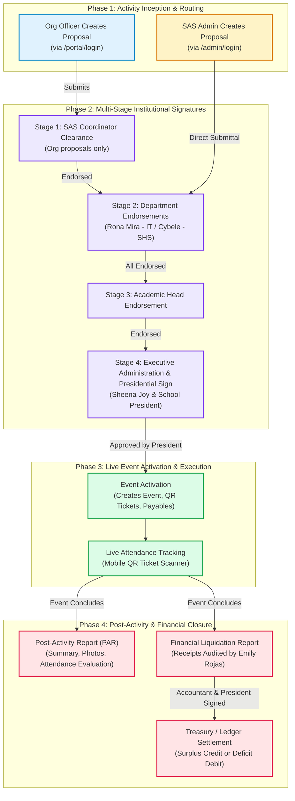
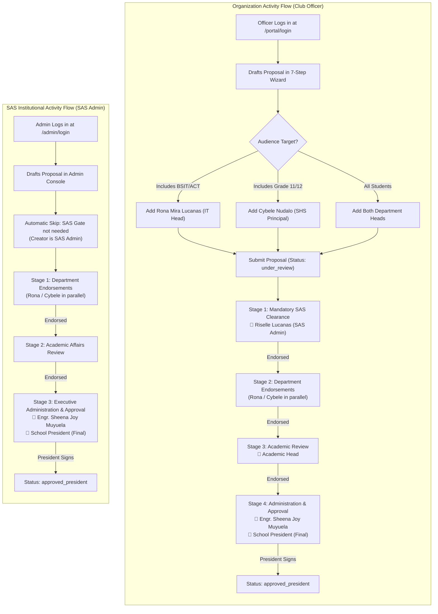
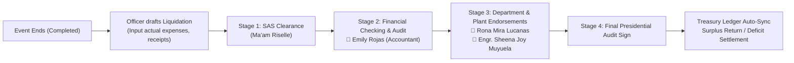

# STI Sync: Complete Activity Lifecycle & Signatory QA Testing Guide

This guide is prepared for team members to conduct comprehensive end-to-end testing of the **STI Sync Activity Lifecycle**, spanning **Student Organization Activities**, **SAS Institutional Activities**, **Multi-Stage Signatory Approvals**, **Event Execution**, and **Post-Activity Liquidation**.

---

## 1. Authentication Portals & Signatory Credentials

The system employs a strict dual-portal architecture to enforce institutional security and role segregation.

### 1.1 Web Portals Overview

| Portal Name | URL | Authorized Roles | Access Policy |
| :--- | :--- | :--- | :--- |
| **Universal Campus Portal** | `http://localhost:5173/portal/login` | • Club Officers<br/>• Club Advisers<br/>• Institutional Signatories | **Universal Entry Point**.<br/>• Club Officers/Advisers redirect to `/officer/dashboard`<br/>• Signatories redirect to `/signatory/endorsements` |
| **SAS Admin Portal** | `http://localhost:5173/admin/login` | • SAS Admin / SAO Coordinator | **Strictly Exclusive** to accounts registered in `sas_admins`. All non-admin accounts are blocked. Redirects to `/admin/dashboard`. |

---

### 1.2 Signatory Test Credentials Directory

| Email | Password | Full Name | Official Role Title | Role Code | Scope | Action Type |
| :--- | :--- | :--- | :--- | :--- | :--- | :--- |
| `rona@gmail.com` | `rona12345` | **Rona Mira Lucanas** | IT Program Head | `it_program_head` | Proposals & Liquidation | **Endorser** (`endorse`) |
| `sheena@gmail.com` | `sheena12345` | **Engr. Sheena Joy Muyuela** | School Administrator | `school_administrator` | Proposals & Liquidation | **Endorser / Approver** (`both`) |
| `cybele@gmail.com` | `cybele12345` | **Cybele Nudalo** | SHS Asst. Principal | `shs_asst__principal` | Proposals & Liquidation | **Endorser** (`endorse`) |
| `emily@gmail.com` | `emily12345` | **Emily Rojas** | School Accountant | `school_accountant` | **Liquidation Only** | **Financial Auditor** (`check`) |

> [!IMPORTANT]
> **Governance Rule on Accountant Scope (`emily@gmail.com`):**
> Per institutional financial policy, `emily@gmail.com` (School Accountant) is configured with `applicableScope: "liquidation_only"`. She will **never** appear in initial Activity Proposals; she is triggered **strictly during Financial Liquidation Reports** to audit official receipts, invoices, and expense vouchers.

---

## 2. End-to-End Activity Lifecycle Diagrams

### 2.1 The Unified Activity Cycle (Macro View)



---

### 2.2 Organization Activity Flow vs. SAS Institutional Activity Flow



---

### 2.3 Granular Inline Revision & Return Loop

```mermaid
sequenceDiagram
    autonumber
    actor Officer as Club Officer
    actor Signatory as Signatory (e.g. Rona Mira - IT Head)
    participant System as STI Sync Engine
    actor Admin as SAS Admin

    Officer->>System: Submits Proposal (under_review)
    Note over System: Proposal enters Stage 2 (Current)
    Signatory->>System: Logs in via /portal/login -> /signatory/endorsements
    Signatory->>System: Clicks "Review Proposal"
    Signatory->>System: Highlights Objective & adds inline remark: "Adjust target headcount to 80"
    Signatory->>System: Clicks "Return for Revision"
    System->>Officer: Notifies Officer; Status becomes 'returned_for_revision'
    Note over Officer: Sections flagged in amber are unlocked
    Officer->>System: Adjusts headcount to 80 and clicks "Resubmit Revision"
    System->>Signatory: Restores proposal directly to Stage 2 (signatory queue)
    Signatory->>System: Affixes Verified Digital Signature & Clicks "Endorse"
    System->>System: Advances to Next Approval Stage
```

---

### 2.4 Financial Liquidation Signatory Chain (Emily Rojas Audit Flow)



---

## 3. Step-by-Step Test Scenarios

### Test Suite 1: Organization Activity Flow (Officer Portal)

#### Objective
Verify that an activity proposal created by a student club officer starts at Stage 1 (SAS Gatekeeper), enforces audience-based department endorsements (Rona/Cybele), requires School Administrator endorsement (Sheena), and completes upon Presidential signature.

#### Test Execution Steps

1. **Step 1: Proposal Drafting & Audience Selection**
   - **URL**: `http://localhost:5173/portal/login`
   - **Credentials**: Any assigned Officer account (or use test seeder officer).
   - **Action**: Navigate to `Activity Proposals` $\rightarrow$ Click **"New Activity Proposal"**.
   - **Fill Wizard**:
     - *Step 1: General Info*: Title: `CodeCrafters Hackathon 2026`, Organization: `Computer Science Society`.
     - *Step 2: Target Audience*: Select **BSIT** and **Senior High School (STEM)**.
     - *Step 3: Sessions*: Add 1 Session (`Day 1 Coding Challenge`).
     - *Step 4: Budget*: Add `P2,500` under Speaker Honorarium.
     - *Step 5: Review & Flow Builder*: Observe the auto-suggested chain.
   - **Expected Condition & Result**:
     - Stage 1 is automatically set to **Student Affairs & Services (SAS) Clearance**.
     - Stage 2 automatically pulls **Rona Mira Lucanas** (due to BSIT) and **Cybele Nudalo** (due to SHS STEM).
     - Stage 3/4 includes **Engr. Sheena Joy Muyuela** (School Administrator) and **School President**.
   - Click **"Submit Proposal"**.
   - **Database Status**: `under_review`, `currentStageIndex: 1`.

2. **Step 2: Stage 1 SAS Review (Ma'am Riselle)**
   - **URL**: `http://localhost:5173/admin/login`
   - **Credentials**: SAS Admin (`riselle.lucanas@sti.edu.ph` / Admin Password).
   - **Action**: Navigate to `Activity Proposals` $\rightarrow$ Locate `CodeCrafters Hackathon 2026` $\rightarrow$ Click **"Review"**.
   - Verify Stage 1 is marked `CURRENT`, while Stages 2–4 are `WAITING`.
   - Affix signature and click **"Endorse Proposal"**.
   - **Expected Condition & Result**:
     - Stage 1 step updates to `endorsed`.
     - Proposal transitions to `currentStageIndex: 2`.
     - Stage 2 steps (Rona and Cybele) transition from `waiting` to `current`.

3. **Step 3: Parallel Department Review (Rona Mira & Cybele Nudalo)**
   - **Test 3A: Rona Mira Lucanas (IT Head)**:
     - **URL**: `http://localhost:5173/portal/login`
     - **Credentials**: `rona@gmail.com` / `rona12345`.
     - System redirects directly to `/signatory/endorsements`.
     - Locate `CodeCrafters Hackathon 2026` under **"Pending My Endorsement"**.
     - Click **"Review Document"** $\rightarrow$ Affix Digital Signature $\rightarrow$ Click **"Endorse"**.
     - *Condition Check*: Proposal remains at Stage 2 because Cybele has not yet signed.
   - **Test 3B: Cybele Nudalo (SHS Assistant Principal)**:
     - **URL**: `http://localhost:5173/portal/login`
     - **Credentials**: `cybele@gmail.com` / `cybele12345`.
     - Locate `CodeCrafters Hackathon 2026` under **"Pending My Endorsement"**.
     - Affix Digital Signature and click **"Endorse"**.
   - **Expected Condition & Result**:
     - Both Stage 2 parallel steps are now `endorsed`.
     - Stage 2 completes automatically; system advances proposal to `currentStageIndex: 3` (Executive Stage).

4. **Step 4: Executive Administration & Presidential Sign (Sheena & President)**
   - **URL**: `http://localhost:5173/portal/login`
   - **Credentials**: `sheena@gmail.com` / `sheena12345`.
   - Click **"Review Document"** $\rightarrow$ Affix Digital Signature $\rightarrow$ Click **"Endorse"**.
   - Log in as the **School President** (or execute presidential approval step via admin bypass/president account).
   - **Expected Condition & Result**:
     - Proposal status transitions to `approved_president`.
     - **"Activate Event"** button is unlocked.

---

### Test Suite 2: SAS / Institutional Activity Flow (Admin Portal)

#### Objective
Verify that an Institutional Activity created directly by the SAS Admin skips Stage 1 clearance and directly activates parallel departmental and administrative endorsements.

#### Test Execution Steps

1. **Step 1: Institutional Proposal Creation**
   - **URL**: `http://localhost:5173/admin/login`
   - **Credentials**: SAS Admin (`riselle.lucanas@sti.edu.ph`).
   - **Action**: Navigate to `Activity Proposals` $\rightarrow$ Click **"Create Institutional Proposal"**.
   - Enter Title: `STI Campus Sports Olympiad 2026`.
   - Set Target Market: **All College Departments & Senior High School**.
   - Verify Flow Builder: Observe that Stage 1 SAS Endorsement is **omitted**.
   - Click **"Publish & Dispatch for Signatures"**.
   - **Expected Condition & Result**:
     - Proposal status becomes `under_review`.
     - `currentStageIndex: 1` begins directly with Department Heads (Rona Mira Lucanas and Cybele Nudalo).

2. **Step 2: Verify Signatory Queues**
   - Log in as `rona@gmail.com` at `http://localhost:5173/portal/login`.
   - Verify `STI Campus Sports Olympiad 2026` appears in the pending queue immediately without prior SAS gate approval.

---

### Test Suite 3: Inline Revision & Remark Return Loop

#### Objective
Verify that any reviewer can return a proposal with granular, section-targeted feedback, and that resubmitting returns it directly to the active stage.

#### Test Execution Steps

1. Create a test proposal and submit it.
2. Log in as an active endorser (e.g. `rona@gmail.com`).
3. Click **"Review Document"**:
   - In the interactive document view, click the **Objectives** section.
   - Enter remark: `"Objective 2 is ambiguous; please align with CISO campus cybersecurity guidelines."`
   - Click **"Return for Revision"**.
4. **Verification in Officer Portal**:
   - Log in as the originating Officer.
   - Proposal banner shows **Amber Alert**: `Returned for Revision`.
   - The *Objectives* card is highlighted in amber with Rona's exact comment.
   - Other approved sections remain intact.
5. **Resubmission**:
   - Officer updates Objective 2 and clicks **"Resubmit Proposal"**.
   - Proposal status reverts to `under_review`.
   - Log in as `rona@gmail.com`: Proposal is restored to her pending queue for final endorsement.

---

### Test Suite 4: Post-Activity Financial Liquidation (Emily Rojas Audit Flow)

#### Objective
Verify that `emily@gmail.com` (School Accountant) is specifically required for Financial Liquidations, reviews expense receipts, and that surplus/deficit is settled in the ledger.

#### Test Execution Steps

1. **Step 1: Event Completion & Liquidation Initiation**
   - After an approved event concludes, navigate to `Officer Portal` $\rightarrow$ `Finance Center` $\rightarrow$ `Financial Liquidation`.
   - Click **"Create Liquidation Report"**.
   - Enter Actual Spent amount (e.g., Budget was `₱3,000`, Actual Expense is `₱2,600`, generating a `₱400` Surplus).
   - Upload receipt proof images.
   - Submit for Liquidation Review.

2. **Step 2: Signatory Chain Verification**
   - Inspect the generated Liquidation Signatory Chain:
     - Stage 1: SAS Coordinator Clearance.
     - **Stage 2: Financial Checking & Audit $\rightarrow$ `emily@gmail.com` (Emily Rojas - School Accountant)**.
     - Stage 3: Department & Administration Endorsements (`rona@gmail.com`, `sheena@gmail.com`).
     - Stage 4: School President.

3. **Step 3: Accountant Sign-Off**
   - **URL**: `http://localhost:5173/portal/login`
   - **Credentials**: `emily@gmail.com` / `emily12345`.
   - Verify Emily is redirected to `/signatory/endorsements`.
   - Locate the liquidation document under **"Liquidations Pending My Audit"**.
   - Verify the table of line items, receipt attachments, and disbursement summary.
   - Affix digital signature and click **"Certify & Endorse Audit"**.
   - **Expected Condition & Result**:
     - Step status changes to `checked` / `endorsed`.
     - Advances to administrative & presidential signers.
     - Once approved by the President, `₱400` unused budget is credited back to the Organization Ledger as `liquidation_surplus`.

---

## 4. Expected Results & Database State Matrix

| State / Trigger | Proposal Status (`overallStatus`) | Active Stage (`currentStageIndex`) | UI & Operational Effect |
| :--- | :--- | :--- | :--- |
| **Org Officer Submits** | `under_review` | `1` | Locked for editing; visible in SAS Admin queue. |
| **SAS Admin Endorses Stage 1** | `under_review` | `2` | Stage 1 displays green checkmark; Rona & Cybele receive pending notifications. |
| **Signatory Clicks Return** | `returned_for_revision` | Remains at current stage | Unlocks proposal for officer; flagged sections display remarks in amber. |
| **Officer Resubmits Revision** | `under_review` | Resumes active stage | Re-enters queue of the signatory who requested changes. |
| **All Department Heads Sign** | `under_review` | `3` (or `4`) | Advances automatically to School Administrator & President. |
| **President Affixes Signature** | `approved_president` | Completed | **"Activate Event"** button unlocks; budget allocation is debited from ledger. |
| **Activate Event Clicked** | `activated` | Completed | Event appears on Mobile Student App; QR ticket scanners enabled. |
| **Liquidation Approved by Emily & President** | `settled` | Completed | Surplus/deficit auto-balanced in Organization/School Ledger. |

---

## 5. Troubleshooting & QA Checklist

- [ ] **Can an officer log in via `/admin/login`?**  
  *Expected*: System blocks authentication with error: *"No admin profile found for this account. Contact your system administrator."*
- [ ] **Does a signatory logging in at `/portal/login` go to officer dashboard?**  
  *Expected*: No. System recognizes `isSignatory: true` and automatically routes them to `/signatory/endorsements`.
- [ ] **Does Emily Rojas (`emily@gmail.com`) appear in Step 7 of Activity Proposal Wizard?**  
  *Expected*: **No.** Filter in `proposal-routing.ts` blocks all `liquidation_only` / accountant roles from activity proposals.
- [ ] **Does Emily Rojas appear in Post-Event Financial Liquidation?**  
  *Expected*: **Yes.** Stage 2 specifically loads active institutional accountants for financial voucher auditing.
- [ ] **Do parallel signers block each other?**  
  *Expected*: No. Rona and Cybele can review and affix signatures in any sequence. The stage only advances when both steps are complete.
