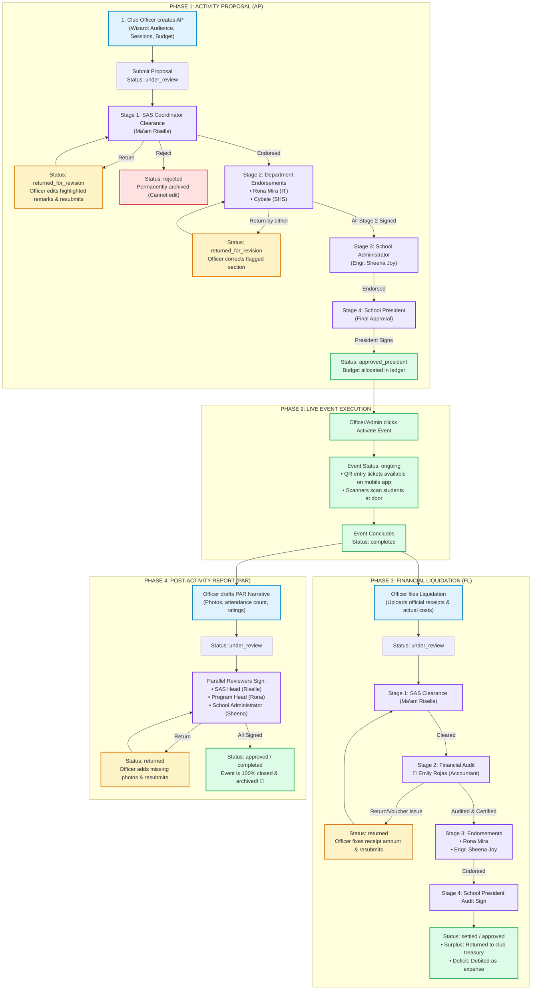
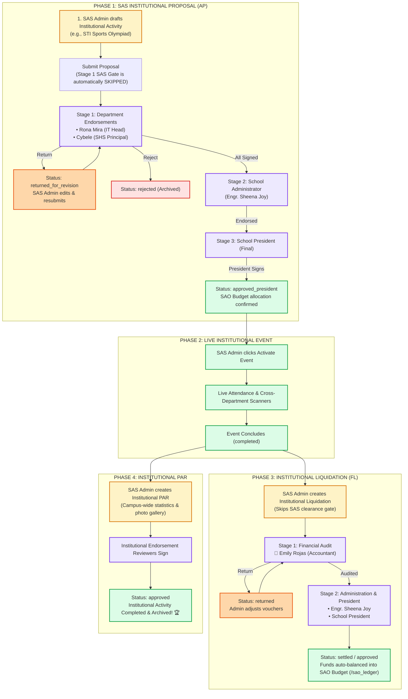

# STI Sync – Complete Activity Lifecycle & Signatory Testing Guide
> **The Official Testing Handbook for Team Members.**  
> Covers the full lifecycle: **Activity Proposal (AP)** $\rightarrow$ **Event Execution** $\rightarrow$ **Financial Liquidation (FL)** $\rightarrow$ **Post-Activity Report (PAR)** for both **Organization Activities** and **SAS Admin Activities**, including approvals, returns, and rejections.

---

## 🔑 1. Quick Access Links & Signatory Logins

### 🌐 The 2 Portals

| Portal | URL | Who Logs In Here? |
| :--- | :--- | :--- |
| **Universal Campus Portal** | [http://localhost:5173/portal/login](http://localhost:5173/portal/login) | **Club Officers**, **Club Advisers**, and **Signatories** (Rona, Sheena, Cybele, Emily). *(Officers go to Officer Dashboard; Signatories automatically land on their Signing page).* |
| **SAS Admin Portal** | [http://localhost:5173/admin/login](http://localhost:5173/admin/login) | **SAS Admin ONLY** (`riselle.lucanas@sti.edu.ph` / SAO Head). *(Officers and Signatories cannot log in here).* |

---

### 👤 Signatory Test Accounts Directory

| Email | Password | Name | Position | What do they sign? |
| :--- | :--- | :--- | :--- | :--- |
| **`rona@gmail.com`** | `rona12345` | **Rona Mira Lucanas** | IT Program Head | Signs AP, FL, and PAR when the event targets **IT / ACT / College** students. |
| **`cybele@gmail.com`** | `cybele12345` | **Cybele Nudalo** | SHS Asst. Principal | Signs AP, FL, and PAR when the event involves **Senior High School (STEM, TVL, HUMSS, ABM)** students. |
| **`sheena@gmail.com`** | `sheena12345` | **Engr. Sheena Joy Muyuela** | School Administrator | Signs all AP, FL, and PAR to verify campus facilities, logistics, and physical plant safety. |
| **`emily@gmail.com`** | `emily12345` | **Emily Rojas** | School Accountant | **Financial Liquidation ONLY**: Audits official receipts, expense vouchers, and computes surplus/deficit. *(Never signs AP or PAR).* |

---

## 🏛️ PART 1: Organization Activity Full Lifecycle
*(Originates from a **Student Club Officer** via [http://localhost:5173/portal/login](http://localhost:5173/portal/login))*

---

### 📝 Step-by-Step Walkthrough for Organization Activities

#### Step 1: Create & Submit Activity Proposal (AP)
1. Log in at [http://localhost:5173/portal/login](http://localhost:5173/portal/login) as an **Organization Officer**.
2. Go to **Activity Proposals** $\rightarrow$ Click **"New Activity Proposal"**.
3. Fill out the wizard:
   - **Title**: e.g., `CodeCrafters Hackathon 2026`.
   - **Audience**: Select **BSIT** (calls Rona) and **SHS STEM** (calls Cybele).
   - **Budget**: Add line items (e.g., `₱3,000` for Speaker & Prizes).
4. Click **"Submit Proposal"**.
   - **Current Status**: `under_review`.
   - **Active Step**: Stage 1 (SAS Gatekeeper).

#### Step 2: Approvals, Returns & Rejections in AP
- **Stage 1 (SAS Gatekeeper)**: Log in as SAS Admin at [http://localhost:5173/admin/login](http://localhost:5173/admin/login).
  - *Option A (Approve)*: Click **"Endorse Proposal"** $\rightarrow$ Stage 1 turns green; Stage 2 unlocks for Rona & Cybele.
  - *Option B (Return)*: Click **"Return for Revision"** with a remark $\rightarrow$ Status changes to `returned_for_revision`. The Officer's dashboard highlights the requested changes in yellow. Once edited and resubmitted, it returns to Stage 1.
  - *Option C (Reject)*: Click **"Disapprove / Reject"** with a reason $\rightarrow$ Status becomes `rejected`. The proposal is permanently locked and archived.
- **Stage 2 (Department Heads)**:
  - Log in as `rona@gmail.com` (`rona12345`) at `/portal/login` $\rightarrow$ Affix signature and click **Endorse**.
  - Log in as `cybele@gmail.com` (`cybele12345`) at `/portal/login` $\rightarrow$ Affix signature and click **Endorse**.
  - *(Note: Rona and Cybele sign in parallel; either can sign first).*
- **Stage 3 & 4 (Administrator & President)**:
  - Log in as `sheena@gmail.com` (`sheena12345`) at `/portal/login` $\rightarrow$ Sign and endorse.
  - School President signs $\rightarrow$ Status updates to `approved_president`.

#### Step 3: Event Activation & Live Execution
1. In the proposal, click **"Activate Event"**.
2. Event status becomes `published` / `ongoing`.
3. Students view the event and entry QR tickets on their mobile app.
4. Officers use the QR scanner to record attendance (`present`, `late`, `absent`).
5. When all sessions are finished, the event marks as `completed`.

#### Step 4: Financial Liquidation (FL) & Emily Rojas (Accountant)
1. As the Club Officer, go to **Finance Center** $\rightarrow$ **Financial Liquidation** $\rightarrow$ **Create Liquidation**.
2. Enter the actual spent amounts (e.g., Budget was `₱3,000`, actual spent was `₱2,600`, generating `₱400` surplus) and upload receipt attachments.
3. Submit the report:
   - **Stage 1**: SAS Admin clears the liquidation.
   - **Stage 2 (Accountant Audit)**: Log in as `emily@gmail.com` (`emily12345`) at `/portal/login`.
     - Emily verifies receipts and numbers.
     - *If an error exists*: Emily clicks **Return** with comments $\rightarrow$ Status becomes `returned`. Officer uploads the correct receipt and resubmits.
     - *If valid*: Emily clicks **"Certify & Endorse Audit"**.
   - **Stage 3 & 4**: Rona, Sheena, and President sign off.
   - **Result**: The `₱400` unused budget is automatically credited back to the Club Treasury Ledger as `liquidation_surplus`.

#### Step 5: Post-Activity Report (PAR)
1. As the Club Officer, open the completed event $\rightarrow$ Click **"Draft Post-Activity Report"**.
2. Enter the summary narrative, upload documentation photos, and attach the attendance stats.
3. Submit for review:
   - SAS Admin, IT Head (Rona), and School Admin (Sheena) review in parallel.
   - *If returned*: Officer adds missing photos/info and resubmits.
   - *When all sign*: PAR status becomes `approved`. The entire event cycle is officially 100% closed!

---

## 🏢 PART 2: SAS / Institutional Activity Full Lifecycle
*(Originates from **SAS Admin** via [http://localhost:5173/admin/login](http://localhost:5173/admin/login))*

---

### 📝 Step-by-Step Walkthrough for SAS Admin Activities

#### Step 1: Create & Submit Institutional Proposal (AP)
1. Log in at [http://localhost:5173/admin/login](http://localhost:5173/admin/login) as **SAS Admin**.
2. Go to **Activity Proposals** $\rightarrow$ Click **"Create Institutional Proposal"**.
3. Select Target Audience: **All College Departments & Senior High School**.
4. Set Budget: e.g., `₱10,000` (Source: Student Affairs Campus Fund).
5. Notice: **Stage 1 (SAS Gate) is not present** because SAS Admin is the creator.
6. Click **"Submit Proposal"**.
   - **Current Status**: `under_review`.
   - **Active Step**: Stage 1 starts directly with Department Heads (Rona and Cybele).

#### Step 2: Department & Executive Approvals
- Log in as `rona@gmail.com` at `/portal/login` $\rightarrow$ Sign & endorse.
- Log in as `cybele@gmail.com` at `/portal/login` $\rightarrow$ Sign & endorse.
- Log in as `sheena@gmail.com` at `/portal/login` $\rightarrow$ Sign & endorse.
- School President affixes signature $\rightarrow$ Status: `approved_president`.

#### Step 3: Event Execution & Live Attendance
- In Admin Console, click **"Activate Event"**.
- Campus scanners scan attendees. Fines, payables, and attendance logs are monitored directly in the Admin console.

#### Step 4: Institutional Financial Liquidation (FL)
1. Go to **Admin Console** $\rightarrow$ **Financial Liquidation** $\rightarrow$ **Create Institutional Liquidation**.
2. Enter official receipts and invoice proof.
3. Submit for audit:
   - **Stage 1 (Accountant)**: `emily@gmail.com` (`emily12345`) logs in at `/portal/login` and audits vouchers.
   - **Stage 2**: School Administrator (`sheena@gmail.com`) and School President give final audit approval.
   - **Result**: Remaining budget automatically settles back into the SAO Central Ledger (`/sao_ledger`).

#### Step 5: Institutional Post-Activity Report (PAR)
1. SAS Admin drafts the campus-wide PAR with official documentation and survey analytics.
2. Signatories sign in parallel $\rightarrow$ Status: `approved`. The event is 100% finished and archived.

---

## 🚦 5. Status & Decision Reference Table

| Status | What It Means | Who Can Take Action? | What Happens Next? |
| :--- | :--- | :--- | :--- |
| **`draft`** | Proposal, FL, or PAR is being drafted. | Creator (Officer or Admin) | Creator can edit and click "Submit". |
| **`under_review`** | Waiting for signatures in the active stage. | Active Signatories of that stage | Signatories review, affix signature, and click "Endorse". |
| **`returned_for_revision`** (or `returned`) | Reviewer found an error or asked for changes. | Creator (Officer or Admin) | Sections with remarks are highlighted in yellow. Creator edits and clicks "Resubmit". |
| **`rejected`** | Reviewer or SAS Admin permanently disapproved. | None (Dead-end) | Proposal is archived. Creator cannot edit or resubmit. |
| **`approved_president`** (AP) | Final Presidential signature is affixed. | Officer or Admin | **"Activate Event"** button unlocks; budget is allocated. |
| **`ongoing`** / **`published`** | Event is currently live. | Scanners & Students | Students scan QR tickets; attendance updates in real time. |
| **`completed`** | Event sessions are done. | Officer or Admin | Unlocks drafting of **Financial Liquidation (FL)** and **PAR**. |
| **`settled`** / **`approved`** (FL/PAR) | Liquidation audited by Emily & President; PAR signed. | Completed | Surplus/deficit auto-credited in ledger; event is 100% closed. |

---

## 🔍 6. How to Test Visual Revision Diff & Side-by-Side Comparison

When an Activity Proposal (AP), Financial Liquidation (FL), or Post-Activity Report (PAR) is returned for revision and then resubmitted with edits, reviewers (SAS Admin and Institutional Signatories) can visually compare what was changed.

### 🧪 Test Scenario: Activity Proposal (AP) Revision
1. **Officer Submits Proposal**:
   - Log in as an Officer at [http://localhost:5173/portal/login](http://localhost:5173/portal/login).
   - Create an Activity Proposal titled `"AI & Robotics Symposium 2026"` with Total Budget `₱5,000` and Expected Pax `100`. Submit for review.
2. **Signatory Returns Proposal for Revision**:
   - Log in as a Signatory (e.g. `rona@gmail.com` / `rona12345`) at [http://localhost:5173/portal/login](http://localhost:5173/portal/login).
   - Open the proposal in **Endorsement Studio** $\rightarrow$ Click **"Return for Revision"**.
   - Input remark: *"Please update target attendance to 150 pax and adjust budget to ₱7,500."* Click confirm.
3. **Officer Edits & Resubmits**:
   - Officer logs back in, sees the **Revision Feedback Banner** with Rona's feedback.
   - Click **"Edit & Resubmit"** $\rightarrow$ Change Budget to `₱7,500` and Pax to `150` $\rightarrow$ Submit.
4. **Signatory / SAS Admin Verifies the Changes**:
   - Log in as Signatory (`rona@gmail.com`) or SAS Admin (`/admin/login`).
   - Open the resubmitted proposal.
   - Notice the **"Compare Changes"** button with a pill indicating the number of detected modifications.
   - Notice the **Inline Revision Badges** (`✏️ Revised`) next to modified fields.
   - Click **"Compare Changes"**: A modal displays side-by-side comparison with green additions (`+`), red removals (`-`), previous values, and current values!

### 🧪 Test Scenario: Financial Liquidation (FL) Revision
1. Officer submits LF-01 with itemized receipts.
2. Emily Rojas (`emily@gmail.com` / `emily12345`) flags a missing official receipt and returns the liquidation.
3. Officer re-uploads the verified BIR receipt or adjusts the expense total and resubmits.
4. When Emily or SAS Admin opens the resubmitted liquidation in **Dual-Pane Verification Studio**, clicking **"Compare Changes"** immediately highlights which expense items or receipt numbers were modified!

### 🧪 Test Scenario: Post-Activity Report (PAR) Revision
1. Officer submits Form PAR.
2. Reviewer returns PAR requesting verified participant attendance numbers.
3. Officer updates actual attendee count and resubmits.
4. Reviewer opens **PAR Detail Modal** $\rightarrow$ **"Compare Changes"** button and inline badge on `Attended (Scanned)` display the exact delta!

