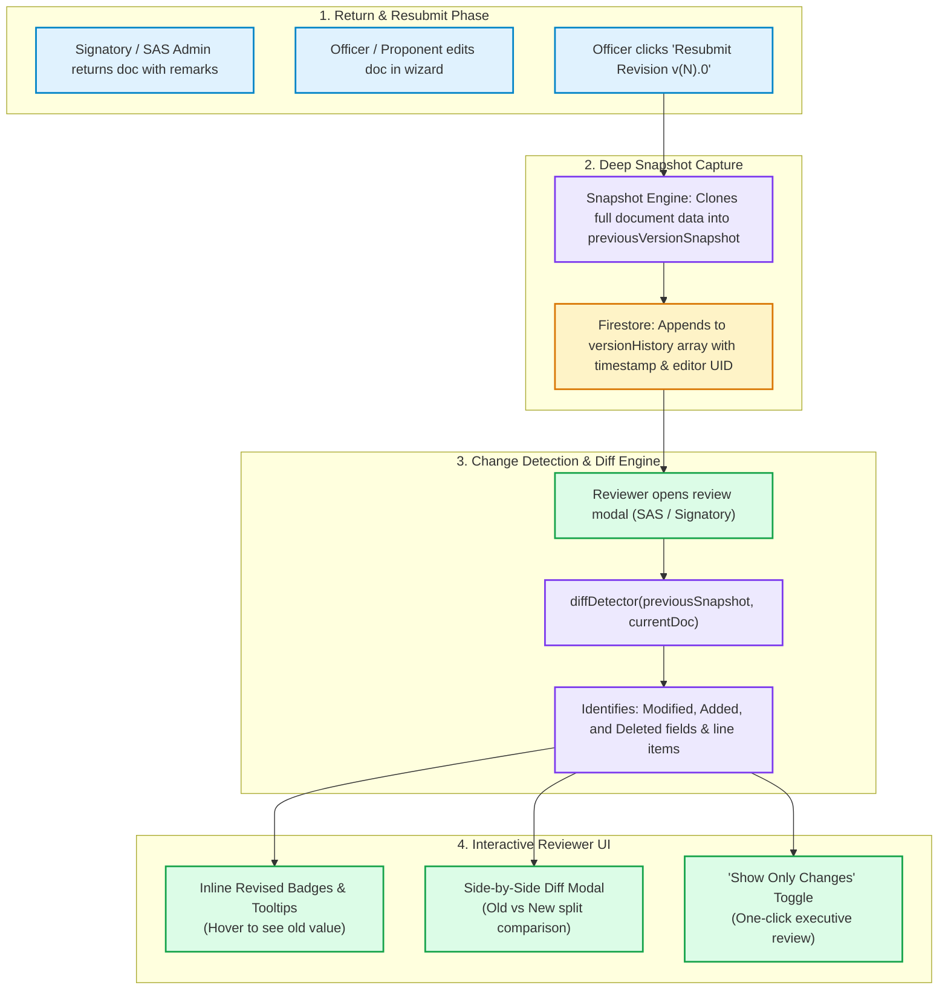
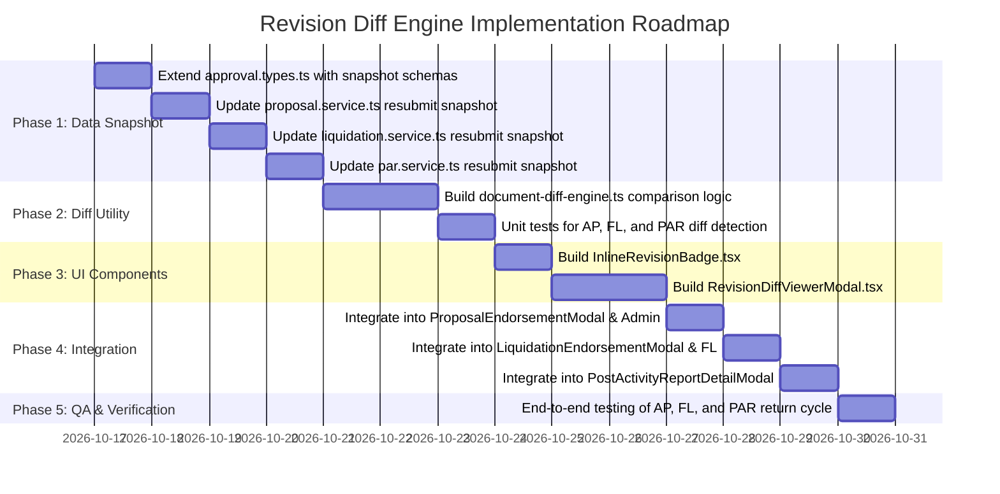

# Implementation Plan: Universal Revision Diff & Change Comparison Engine (AP, FL, & PAR)

## Executive Summary
When an **Activity Proposal (AP)**, **Financial Liquidation (FL)**, or **Post-Activity Report (PAR)** is returned for revision and subsequently resubmitted by a Student Club Officer or SAS Admin, reviewers (SAS Coordinator, Program Heads, Principals, Accountants, and the School President) must be able to **instantly see what was changed** between revisions.

This implementation plan details the architecture, data snapshot engine, change detection algorithm, and interactive UI components to provide:
1. **Inline Revision Badges**: Visual indicators (amber/blue tags) marking sections, line items, or dates that were edited, added, or removed.
2. **Side-by-Side Diff Comparison View**: A split or unified comparison table allowing signatories to view **Version N-1 (Original)** vs. **Version N (Revised)**.
3. **"Show Only Changes" Filter**: A 1-click toggle allowing busy signatories (like the School Administrator or Program Heads) to review only modified items without re-reading unchanged content.

---

## 1. Problem Analysis & Current Gaps

| Document Type | What is Currently Stored on Return & Resubmit | The Gap / Missing Feature |
| :--- | :--- | :--- |
| **Activity Proposals (AP)** | Only metadata (`returnFlags`, `stepRevisionRemarks`, reviewer name) is stored in `versionHistory`. | **No actual data snapshot** of previous title, budget items, sessions, or objectives is preserved. Reviewers cannot verify if budget was sneakily inflated. |
| **Financial Liquidation (FL)** | `revisionHistory` stores `returnRemarks`, `returnedAt`, and `resubmittedAt`. | **No record of previous receipts or line-item spent amounts**. Emily Rojas (Accountant) cannot see which receipt was swapped or which expense line was adjusted. |
| **Post-Activity Reports (PAR)** | `revisionHistory` stores `versionLabel`, `returnedBy`, and `returnRemarks`. | **No snapshot of previous attendee numbers, narrative text, or evaluation scores**. |
| **Reviewer UI (All 3 Docs)** | Reviewers only see the latest version in full with yellow remarks on top. | **No "Compare Versions" toggle, no diff viewer, and no inline field highlights** showing old vs. new values. |

---

## 2. Proposed Architecture & System Workflow



---

## 3. Data Model Enhancements

### 3.1 Enhanced `RevisionHistoryEntry` / `DocumentVersionSnapshot`

In `src/app/modules/workflow/types/approval.types.ts`, extend the schema to support deep data snapshots:

```typescript
export type DiffFieldType = 'text' | 'number' | 'currency' | 'date' | 'array_items' | 'status';
export type DiffChangeType = 'added' | 'removed' | 'modified' | 'unchanged';

export interface FieldDiffEntry {
  fieldPath: string;           // e.g. "budget.lineItems[0].totalCost" or "sessions[0].date"
  label: string;               // Human-readable title: "Session 1 Date" or "Key Objective 2"
  section: string;             // "General Info" | "Target Audience" | "Budget" | "Logistics"
  changeType: DiffChangeType;  // 'added' | 'removed' | 'modified'
  oldValue: any;               // ₱2,500
  newValue: any;               // ₱2,000
  diffSummary?: string;        // "Reduced from ₱2,500 to ₱2,000"
}

export interface DocumentVersionSnapshot {
  version: number;             // e.g. 1
  versionLabel: string;        // "v1.0"
  archivedAt: string;          // ISO string
  resubmittedAt: string;       // ISO string
  resubmittedBy: string;       // "John Doe (Officer)"
  resubmittedByUid: string;
  returnRemarks?: string;      // "Please align speaker honorarium with school cap."
  returnedBy?: string;         // "Rona Mira Lucanas"
  returnedByRoleTitle?: string;// "IT Program Head"
  
  // THE CRITICAL ADDITION: Deep snapshot of the exact document state prior to edits
  dataSnapshot: Record<string, any>;
  
  // Computed field diffs cached upon resubmission
  detectedDiffs?: FieldDiffEntry[];
}
```

---

## 4. Document-Specific Diff Strategies

### 4.1 Activity Proposals (AP)
* **What to Compare**:
  - **Header / Meta**: Title, Description, Expected Headcount, Target Departments.
  - **Sessions Scheduler**: Session title, date, time slots (`startTime`, `endTime`), venue.
  - **Financial Projections**: Line-item name, category, quantity, unit cost, and total cost (`totalAllocatedBudget`).
  - **Audience & Programs**: Selected courses (e.g. BSIT, STEM).
* **Expected UI Highlight**:
  - If a budget line was lowered, highlight the cell in **Amber** with a tag: `[Revised: Was ₱2,500 ➔ Now ₱2,000]`.
  - If a session venue changed from Lab 2 to Lab 1, badge it: `[Venue Changed]`.

### 4.2 Financial Liquidation (FL)
* **What to Compare**:
  - **Line Items**: Item description, official receipt / invoice number, vendor name, quantity, and actual amount.
  - **Variance**: Allocated budget vs. actual spent (Surplus or Deficit change).
  - **Receipt Proofs**: Added, removed, or updated receipt image attachments.
* **Expected UI Highlight**:
  - Emily Rojas sees receipt items with a green tag `[New Receipt Attached]` or an amber badge `[Amount Corrected: ₱1,450 ➔ ₱1,200]`.

### 4.3 Post-Activity Reports (PAR)
* **What to Compare**:
  - **Metrics**: Actual student attendance count vs. targeted headcount.
  - **Executive Narrative**: Event background, outcomes, and lessons learned.
  - **Student Evaluations**: Average satisfaction rating, speaker scores.
  - **Documentation Attachments**: Newly added event photo evidence.
* **Expected UI Highlight**:
  - Text additions shown in green background (`+ Added text`); deleted remarks with red strikethrough (`- Removed`).

---

## 5. UI Component Design

### 5.1 `<RevisionDiffViewerModal />`
A centralized, modal dialog accessible from any Review/Endorsement studio:
- **Top Bar**:
  - Version selector: `Compare [v2.0 (Latest) ▼] with [v1.0 (Initial) ▼]`.
  - Summary Pill: `3 Fields Modified · 1 Line Item Added · 0 Removed`.
  - Toggle Button: `[x] Show Only Changed Fields`.
- **Comparison Views**:
  1. **Side-by-Side Split View**: Two clean columns (Old Version on Left with reddish tint, New Version on Right with green tint).
  2. **Unified Summary Table**: Categorized by section (Budget, Schedule, Objectives).

### 5.2 `<InlineRevisionBadge />`
A compact component rendered right next to labels in existing forms:
```tsx
<InlineRevisionBadge 
  changeType="modified" 
  oldValue="₱2,500" 
  newValue="₱2,000" 
  tooltip="Modified in v2.0 per Rona Mira's remark" 
/>
```
Renders as:
`[ ✏️ Revised (was ₱2,500) ]` with an animated pulse on first review.

---

## 6. Detailed Implementation Tasks



### Specific Files to Create / Modify:

1. **`src/app/modules/workflow/utils/document-diff-engine.ts`** *(NEW)*:
   - Core pure functions: `diffActivityProposal()`, `diffFinancialLiquidation()`, `diffPostActivityReport()`.
   - Compares deep objects and returns array of `FieldDiffEntry`.

2. **`src/app/modules/workflow/components/RevisionDiffViewerModal.tsx`** *(NEW)*:
   - Floating comparison studio with split column and unified summary.

3. **`src/app/modules/workflow/components/InlineRevisionBadge.tsx`** *(NEW)*:
   - Reusable badge for highlighting modified fields directly in preview views.

4. **Service Updates (Snapshot Persistence)**:
   - `src/app/modules/activity-proposals/services/proposal.service.ts`: Update `submitProposalForReview()` to clone and save the entire previous state into `dataSnapshot`.
   - `src/app/modules/finance/services/liquidation.service.ts`: Update `updateLiquidationReport()` / `submitLiquidationReport()` to persist previous line items and receipt URLs into `dataSnapshot`.
   - `src/app/modules/post-activity-reports/services/par.service.ts`: Update `saveOrSubmitPAR()` to persist previous narrative and metrics into `dataSnapshot`.

5. **Modal Integrations**:
   - `src/app/signatory/components/ProposalEndorsementModal.tsx`: Add **"View Revision Changes"** button and highlight modified budget cells.
   - `src/app/signatory/components/LiquidationEndorsementModal.tsx`: Add **"Diff View"** for Emily Rojas to audit modified receipts.
   - `src/app/modules/post-activity-reports/components/PostActivityReportDetailModal.tsx`: Add revision comparison tab.
   - `src/app/modules/workflow/components/RevisionFeedbackBanner.tsx`: Embed a direct trigger button: **"Compare What Changed in this Revision"**.

---

## 7. Verification & Acceptance Criteria

- [ ] **AP Test**:
  1. Create a proposal with `₱3,000` budget and 2 sessions.
  2. Signer returns it: *"Change session 1 time and reduce budget to ₱2,000"*.
  3. Officer modifies session 1 time and budget, then resubmits as `v2.0`.
  4. Signer opens review: An amber badge appears: *"Proposal Revised (v2.0)"*.
  5. Signer clicks **"Compare Changes"**: Diff modal clearly highlights the changed budget (`₱3,000` ➔ `₱2,000`) and updated session time in green/red.
- [ ] **FL Test**:
  1. Submit Liquidation with 3 receipts.
  2. Emily Rojas requests a replacement for Receipt #2.
  3. Officer swaps Receipt #2 and resubmits.
  4. Emily logs in: Receipt #2 has an inline badge `[Receipt Replaced]`; previous amount and image are visible in the comparison viewer.
- [ ] **PAR Test**:
  1. Submit PAR with 45 attendees.
  2. Signer returns asking to verify attendance numbers.
  3. Officer corrects headcount to 68 and resubmits.
  4. Signer sees `[Headcount Revised: 45 ➔ 68]`.
